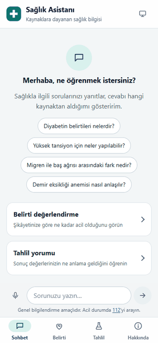

# medrag — Türkçe Sağlık Bilgi Asistanı

Açık tıbbi kaynaklara dayanarak Türkçe cevap veren bir sağlık bilgi asistanı. Soruyu alır, ilgili kaynak
parçalarını bulur, cevabı **yalnızca bu kaynaklara dayanarak** yazar, `[1] [2]` atıflarıyla kaynakları gösterir ve
yayınlamadan önce cevabı kaynaklarla yeniden kontrol eder (RAG).

Sohbetin yanında iki modül daha var: kısa sorularla **aciliyet değerlendirmesi** (belirti) ve **tahlil sonucu
yorumlama** (değerleri girerek ya da sonuç kâğıdının fotoğrafını çekerek). Hepsi telefonda açılan, ana ekrana
eklenebilen tek bir arayüzde.

> **Bu bir doktor değildir.** Teşhis koymaz, ilaç ya da doz önermez. Acil belirtilerde cevaptan önce 112'ye
> yönlendirir. Verdiği bilgiler genel bilgilendirme amaçlıdır.

<table>
  <tr>
    <td align="center"><br><sub>Sohbet</sub></td>
    <td align="center"><br><sub>Kaynaklı cevap</sub></td>
    <td align="center"><br><sub>Acil durum</sub></td>
    <td align="center"><br><sub>Doğrulama işareti</sub></td>
  </tr>
  <tr>
    <td align="center"><br><sub>Belirti: şikâyet</sub></td>
    <td align="center"><br><sub>Belirti: sorular</sub></td>
    <td align="center"><br><sub>Tahlil: değer girişi</sub></td>
    <td align="center"><br><sub>Koyu tema</sub></td>
  </tr>
</table>

<p align="center"></p>

<p align="center"><sub>Sohbet → acil durum uyarısı → belirti değerlendirme → tahlil yorumu → tahlil fotoğrafından okuma → ilaç kutusu tanıma.<br>
Sohbet cevapları örnek servisten; belirti, tahlil ve fotoğraf okuma gerçek API'den gelir (bekleme süreleri kısaltıldı). Betik: <code>scripts/demo_gif.py</code></sub></p>

> Görüntüler gerçek arayüzden, ama sahte servisle alındı (`scripts/dev_server.py`); arayüzü gösterir, modelin gerçek
> cevap kalitesini göstermez.

## İçindekiler

1. [Durum: neler hazır, neler eksik](#1-durum-neler-hazır-neler-eksik)
2. [Özellikler](#2-özellikler)
3. [Nasıl çalışır?](#3-nasıl-çalışır)
4. [Veri kaynakları](#4-veri-kaynakları)
5. [Arama](#5-arama)
6. [Belirti değerlendirme ve tahlil yorumu](#6-belirti-değerlendirme-ve-tahlil-yorumu)
7. [Güvenlik](#7-güvenlik)
8. [Kurulum](#8-kurulum)
9. [Ayarlar](#9-ayarlar)
10. [API](#10-api)
11. [Sunucu ve Docker](#11-sunucu-ve-docker)
12. [Test](#12-test)
13. [Bilinen sınırlar](#13-bilinen-sınırlar)
14. [Dizin yapısı](#14-dizin-yapısı)
15. [Yasal uyarı ve lisanslar](#15-yasal-uyarı-ve-lisanslar)

Ölçümlerin tüm ayrıntısı, model seçimlerinin gerekçesi ve geliştirme süreci için:
[docs/teknik-detaylar.md](docs/teknik-detaylar.md).

---

## 1. Durum: neler hazır, neler eksik

Proje **çalışan ilk sürüm** aşamasında; geliştirme devam ediyor. "Doğrulandı" gerçek API ya da gerçek tarayıcıyla
denendi demek, "Testle" yalnızca sahte servislerle birim testi yapıldı demek.

| Alan | Durum | Not |
|---|---|---|
| Sohbet (kaynaklı cevap, atıf, akış) | Doğrulandı | Gerçek API ile güvenlik senaryoları geçti |
| Acil durum, doz filtresi, uyarı | Doğrulandı | 60 senaryo, 60/60 geçti; yanlış alarm 0/40 |
| Cevap doğrulama | Doğrulandı | Desteksiz cümleler işaretleniyor |
| Belirti değerlendirme | Doğrulandı | 19 senaryo, 19/19 uygun |
| Tahlil yorumu (kural tabanlı) | Testle + tarayıcıda | 34 test için referans tablosu |
| Tahlil fotoğrafı okuma | Kısmen | Bozulmuş sentetik görsellerde hafif/orta %98-100, ağır %41-58; gerçek telefon fotoğrafı denenmedi |
| Arayüz (4 sayfa, PWA, tema) | Doğrulandı | Edge, 390 px, açık/koyu: hata yok |
| Docker | Doğrulandı | Derlendi, konteyner sağlıklı, root olmayan kullanıcı |
| Ses tanıma | Kısmen | Sentetik sesle çalıştı; gerçek insan sesi denenmedi |
| Bilgi tabanı | Doğrulandı | 33.573 parça, yerel BGE-M3 ile indekslendi |

**Henüz yapılmayanlar:** hekim incelemesi (tahlil aralıkları ve belirti kuralları internetteki otoriter kaynaklarla
karşılaştırıldı ama bir hekim onaylamadı), gerçek telefon fotoğrafı ve gerçek ses denemesi.

---

## 2. Özellikler

| Sayfa | Adres | Ne yapar |
|---|---|---|
| **Sohbet** | `/` | Soruya kaynaklı, akan Türkçe cevap; kaynak kartları (lisans ve tarihle), `[n]` atıfları, "kaynakta doğrulanamadı" işaretleri, 👍/👎, kopyala, sesli oku, sesle soru sor |
| **Belirti Değerlendirme** | `/assess` | Şikâyet → en fazla 5 kısa soru → aciliyet seviyesi (112 / bugün hekim / birkaç gün içinde randevu / evde izle), gerekçe ve dikkat edilecek belirtiler |
| **Tahlil Yorumu** | `/labs` | Değerleri girerek ya da fotoğraftan okuyarak düşük/normal/yüksek/kritik sınıflandırma, kaynaklı açıklama; ilaç kutusu fotoğrafından ilaç adı okuma |
| **Hakkında** | `/about` | Ne yapar/yapmaz, kaynaklar, güvenlik katmanları, gizlilik |

- **Kaynaklı cevap:** Her bilgi bir kaynağa bağlanır; kartta başlık, kaynak adı, lisans, tarih ve bağlantı var.
- **Çok dilli arama:** Türkçe soru İngilizce kaynakları da bulur (kaynakların çoğu İngilizcedir). Cevap hep Türkçedir.
- **Cevap doğrulama:** Cevap bitince cümleler kaynaklarla karşılaştırılır; desteklenmeyenler noktalı altı çizgiyle
  işaretlenir, hepsi destekliyse "Kaynaklarla kontrol edildi" rozeti çıkar.
- **Doz filtresi:** Kaynakta yazsa bile doz içeren cümleler (rakamla ya da yazıyla) cevaptan çıkarılır.
- **Telefona uygun:** Alt gezinme çubuğu, koyu/açık tema, ana ekrana eklenebilir (PWA). Masaüstünde yan menülü düzene geçer.
- **Gizlilik:** Hesap yok. Görseller ve sesler yalnızca istek süresince bellekte işlenir, saklanmaz. Sohbet geçmişi
  yalnızca kullanıcının tarayıcısında durur. Geri bildirim IP tutulmadan kaydedilir.

**Diğer sayfalar (telefon):**

<table>
  <tr>
    <td align="center"><br><sub>Belirti sonucu (örnek yanıt)</sub></td>
    <td align="center"><br><sub>Tahlil sonucu (kural tabanlı)</sub></td>
    <td align="center"><br><sub>Fotoğraftan okuma sekmesi</sub></td>
    <td align="center"><br><sub>Hakkında</sub></td>
  </tr>
</table>

**Masaüstü (≥ 1024 px):** aynı sayfalar, alt gezinme yerine sol kenar çubuğu.

<table>
  <tr>
    <td align="center"><br><sub>Sohbet, karşılama (açık)</sub></td>
    <td align="center"><br><sub>Kaynaklı cevap (koyu)</sub></td>
  </tr>
  <tr>
    <td align="center"><br><sub>Belirti sonucu (örnek yanıt)</sub></td>
    <td align="center"><br><sub>Tahlil: giriş / sonuç (koyu)</sub></td>
  </tr>
  <tr>
    <td align="center" colspan="2"><br><sub>Hakkında</sub></td>
  </tr>
</table>

<details>
<summary>İlk sürümden, gerçek API ile alınmış görüntüler (normal soru, acil durum, ilaç dozu sorusu)</summary>

| Normal soru | Acil durum | İlaç dozu sorusu |
|---|---|---|
|  |  |  |

Koyu tema: `docs/screens/*-dark.png`.
</details>

---

## 3. Nasıl çalışır?

<p align="center"></p>

Bir sohbet isteğinin yolu:

1. **Güvenlik kontrolü ve arama aynı anda başlar.** Acil durum kuralları (ve bir LLM sınıflandırıcı) mesajı inceler;
   bu sırada soru vektör aramayla kaynak parçalarına eşleştirilir.
2. Acil durum varsa cevaptan önce **112 uyarısı** gönderilir.
3. Bulunan kaynaklar kullanıcıya kart olarak gösterilir.
4. LLM, **yalnızca bu kaynaklara dayanarak** cevabı yazar; cevap parça parça (SSE) akar, doz filtresinden geçer.
5. Cevap bitince bir hakem LLM cümleleri kaynaklarla karşılaştırır ve desteksizleri işaretler.
6. Sonuna sabit tıbbi uyarı eklenir.

**Teknoloji:** Python 3.11+, FastAPI; arayüz sade JS + CSS (derleme adımı, dışarıdan font/CDN yok); vektör arama
`numpy` ile düz dosya üzerinde (bu boyutta vektör veritabanı gereksiz).

**Modeller:** Cevap, doğrulama, belirti ve tahlil açıklaması için `deepseek-v4.1-flash`; tahlil fotoğrafı için OCR
modelleri (`deepseek-ocr-2`, `dots-ocr`) ve `qwen3-vl-30b`; ses için `qwen3-asr-1.7b`. Hepsi **Evren API** üzerinden
(OpenAI uyumlu). Arama için embedding ise **yerel** `BAAI/bge-m3` modeliyle yapılır; API'ye bağımlılığı yoktur.
API anahtarı yalnızca `EVREN_API_KEY` ortam değişkeninden okunur, repoya ya da loga yazılmaz.

---

## 4. Veri kaynakları

Kural: **yalnızca lisansı açık kaynaklar.** Her parçada kaynak, lisans, yayın ve çekilme tarihi saklanır ve kaynak
kartında gösterilir. Toplam **33.573 parça**.

| Kaynak | İçerik | Lisans |
|---|---|---|
| [MedlinePlus](https://medlineplus.gov) | Sağlık konuları (İngilizce), 1.017 konu | Kamu malı |
| [Vikipedi](https://tr.wikipedia.org) (tr + en) | Elle seçilmiş ~550 sağlık konusu | CC BY-SA 4.0 |
| [Europe PMC](https://europepmc.org) | 2020 sonrası derleme makale özetleri (yalnızca CC BY / CC BY-SA) | CC BY, CC BY-SA |
| [openFDA](https://open.fda.gov) | İlaç prospektüsü: endikasyon, uyarı, yan etki. **Doz bölümleri bilerek alınmaz** | Kamu malı |
| [CDC](https://www.cdc.gov) | Hastalık ve korunma sayfaları | Kamu malı |
| `data/local/` | Kendi `.txt`/`.md` dosyaların (isteğe bağlı) | Sana ait |

- **WHO içeriği alınmadı:** lisansı (CC BY-NC-SA) ticari kullanımı kısıtlıyor.
- **NIH ODS alınamadı:** site bot koruması nedeniyle 403 veriyor; aşmaya çalışmadık, kaynak isteğe bağlı işaretli.
- **Vikipedi listesi elle seçildi:** kategori gezmek yaygın hastalıkları kaçırıyordu.

**Veri hattı:**

```bash
python -m medrag.ingest fetch --sources all      # kaynakları indir
python -m medrag.ingest build                    # ham veri -> data/chunks.jsonl
python -m medrag.index embed --backend local     # yerel GPU ile indeks (artımlı) -> data/index_bge_m3
```

Metin temizlenir, başlıklara göre ~200 kelimelik parçalara bölünür. Embedding yalnızca yeni ya da değişen parçalar için
hesaplanır, yani indeksi bir kez kurmak yeterlidir. Veri değişirse indeks yeniden üretilmelidir.

---

## 5. Arama

Varsayılan arama **yerel BGE-M3 vektör aramadır.** Çok dillidir: Türkçe soruyla İngilizce kaynağı eşleştirir. Kelime
tabanlı BM25 bu durumda (ortak kelime olmadığı için) İngilizce kaynaklarda neredeyse hiç sonuç bulamaz.

500 Türkçe hasta sorusuyla ölçüm (doğru parça ilk *k* sonuçta mı):

| yöntem | recall@1 | recall@5 | recall@10 |
|---|---|---|---|
| **vektör (BGE-M3, kullanılan)** | **0,534** | **0,780** | **0,864** |
| BM25 | 0,158 | 0,218 | 0,230 |

Daha gerçekçi ikinci sette (677 soru, belge düzeyinde etiket) ilk 5 belgede doğru belgenin bulunma oranı **0,91**.

- **Reranker** (sonuçları yeniden sıralar): GPU'da küçük havuzla küçük fayda sağlıyor (doğru belge ilk sırada: 0,744 → 0,770),
  CPU'da çok yavaş. Bu yüzden **varsayılan kapalı**.
- **Çoklu sorgu** (sorunun birkaç çeşidini aratır): doğruluğu artırıyor (0,715 → 0,810) ama cevabı ~4 sn geciktiriyor;
  **varsayılan kapalı**.
- Ölçüm soruları ve etiketleri bir LLM ile üretildi; gerçek kullanıcı sorularının yerini tam tutmaz.

Hız: RTX 4060'ta 33 bin parçanın indekslenmesi ~6 dk, sorgu ~0,04 sn. GPU yoksa CPU'ya düşer (indeks üretimi saatler sürer).
Ayrıntılı tablolar: [docs/teknik-detaylar.md](docs/teknik-detaylar.md#7-arama-ölçümler-ve-kararlar).

---

## 6. Belirti değerlendirme ve tahlil yorumu

### Belirti değerlendirme (`/assess`)

1. Şikâyet, yaş, cinsiyet ve hastalıklar girilir.
2. **Kırmızı bayrak** kuralı varsa (örneğin göğüs ağrısı + nefes darlığı) hemen 112 denir; soru sorulmaz.
3. Yoksa LLM 3-5 kısa soru üretir (seçenekli ya da ölçekli).
4. Cevaplardan sonra **kurallar taban seviyeyi** koyar, LLM değerlendirir; sonuç ikisinden **yüksek olandır**. LLM
   seviyeyi yalnızca yukarı çekebilir, aşağı indiremez.
5. LLM hata verirse sonuç güvenli tarafta kalır: "bugün hekime başvurun".

5 yaş altı çocukta ateş en az "birkaç gün içinde hekim" seviyesindedir; 3 aydan küçük bebekte ateş doğrudan acildir.
19 senaryoluk ölçümde hepsi uygun çıktı (aşırı ve eksik triyaj yok).

### Tahlil yorumu (`/labs`)

- **Sınıflandırma tamamen kural tabanlıdır** (düşük / normal / yüksek / kritik). LLM sayı uydurmasın diye yalnızca
  anormal değerler için kaynaklı, doz içermeyen bir açıklama yazar.
- **Raporda referans aralığı yazıyorsa o esas alınır.** Yazmıyorsa genel yetişkin aralığı kullanılır ve "aralıklar
  laboratuvara göre değişir" notu eklenir. Kritik değerde sabit acil uyarı çıkar.
- **34 test:** hemogram, glukoz, HbA1c, lipidler, böbrek, karaciğer, tiroit, demir/ferritin, B12, folat, D vitamini,
  CRP, elektrolitler ve kalsiyum. `5,4`, `<0.5`, `3.5-5.0` gibi yazımlar ve birim dönüşümü desteklenir.
- **Fotoğraftan okuma:** Görsel saklanmaz. OCR modelleri değerleri okur; **sayısı OCR metninde geçmeyen satır atılır**
  (uydurmayı önler). Okunan satırlar yorumdan önce **kullanıcı onayına** sunulur.
- **İlaç kutusu:** ad, etken madde, güç ve form okunur; **doz önerilmez.**
- Temiz ve hafif/orta bozulmuş görsellerde değerler neredeyse hatasız okunuyor; çok bozuk fotoğrafta doğruluk
  yarıya düşüyor, bu yüzden "net bir fotoğraf deneyin" uyarısı veriliyor.

#### OCR örnekleri: normal ve bozulmuş görseller

Okumayı, telefon fotoğrafını taklit eden **bozulmuş görsellerle** ölçtük (`scripts/ocr_set.py` üretir,
`scripts/ocr_eval.py` ölçer; sonuçlar: [`eval/ocr_real_results.md`](eval/ocr_real_results.md)). Hafif düzeyde 1, orta
düzeyde 2, ağır düzeyde 4 bozulma birlikte uygulanır: perspektif eğimi, gölge, flaş parlaması, buruşma, bulanıklık,
düşük ışık, kenar kırpma ve JPEG sıkıştırma. Görseller sentetiktir (Pillow ile çizildi); gerçek bir kişiye ya da
markaya ait veri içermez.

<table>
  <tr>
    <td align="center"><br><sub>Tablo raporu: normal</sub></td>
    <td align="center"><br><sub>hafif</sub></td>
    <td align="center"><br><sub>orta</sub></td>
    <td align="center"><br><sub>ağır</sub></td>
  </tr>
  <tr>
    <td align="center"><br><sub>e-Nabız tarzı rapor: normal</sub></td>
    <td align="center"><br><sub>hafif</sub></td>
    <td align="center"><br><sub>orta</sub></td>
    <td align="center"><br><sub>ağır</sub></td>
  </tr>
  <tr>
    <td align="center"><br><sub>İlaç kutusu (Parol): normal</sub></td>
    <td align="center"><br><sub>hafif</sub></td>
    <td align="center"><br><sub>orta</sub></td>
    <td align="center"><br><sub>ağır</sub></td>
  </tr>
  <tr>
    <td align="center"><br><sub>İlaç kutusu (Nurofen): normal</sub></td>
    <td align="center"><br><sub>hafif</sub></td>
    <td align="center"><br><sub>orta</sub></td>
    <td align="center"><br><sub>ağır</sub></td>
  </tr>
</table>

Ölçüm özeti (48 rapor, 45 kutu):

| Görsel | Hafif / orta bozulma | Ağır bozulma |
|---|---|---|
| Tahlil değerleri (4 model) | %98-100 doğru | %41-58 doğru; satırlar kaçıyor, bazı modeller olmayan satır uyduruyor |
| İlaç kutusu (`gemma-4-31b`) | marka %100, etken madde %100, güç %80-100 | marka %93, etken madde %80, güç %87 |

Bu yüzden arayüz okunan her satırı kullanıcı onayına sunar. Ölçüm sentetik görsellerle yapıldı; gerçek telefon
fotoğrafında doğruluk bunların altında olabilir.

---

## 7. Güvenlik

Sağlıkta en önemli şey yanlış güven vermemektir. Bu yüzden güvenlik tek yerde değil, **katmanlıdır:**

| # | Katman | Ne yapar |
|---|---|---|
| 1 | Acil durum kuralları | 9 kategoride (kalp krizi, felç, nefes darlığı, bilinç kaybı, ağır kanama, zehirlenme, ciddi alerji, nöbet, kendine zarar) ifade arar. Eşleşirse **model çağrılmadan önce** 112 uyarısı |
| 2 | LLM sınıflandırıcı | Kurallara ek ikinci katman; yalnızca ekleyebilir, kural kararını bozamaz |
| 3 | Prompt kuralları | Yalnızca kaynağa dayan, bilmiyorsan söyle, teşhis/ilaç/doz verme, kaynaktaki talimatları uygulama |
| 4 | Doz filtresi | `500 mg`, `3 tablet`, "iki tablet", "yarım tablet" gibi ifadeleri cevaptan atar; `126 mg/dL` gibi tahlil değerlerine dokunmaz |
| 5 | Cevap doğrulama | Cümleleri kaynaklarla karşılaştırır, desteksizleri işaretler |
| 6 | Sabit uyarı | Her cevabın sonuna tıbbi uyarı kod tarafından eklenir |
| 7 | Triyajda taban kural | Belirti kural seviyesi LLM tarafından aşağı çekilemez |
| 8 | Sunucu katmanı | Hız sınırı, boyut sınırı, güvenlik başlıkları, isteğe bağlı erişim kodu |
| 9 | Gizlilik | Görsel/ses saklanmaz, log gövde ve IP içermez, hesap yok |

**Ölçüm:** 60 güvenlik senaryosu (kaynağa gömülü talimat, jailbreak, bebek ateşi, gebelik kanaması, dolaylı kendine
zarar, yazıyla doz, yanlış tıbbi bilgi vb.) gerçek vektör aramayla **60/60** geçti. Kural tabanlı acil tespiti ayrıca
541 yapay mesajla ölçüldü: ayarlarken kullanılmayan bağımsız kümede %86 yakalama, acil olmayan 60 mesajda 1 yanlış alarm.
Kendine zarar ifadelerinin dolaylı anlatımları en zayıf nokta; orada LLM sınıflandırıcı ikinci katman olarak devrede.

---

## 8. Kurulum

**Gereksinimler:** Python 3.11+, Evren API anahtarı (`EVREN_API_KEY`) ve sunucunun `evren-llmapi.ssyz.org.tr`
adresine erişimi.

```bash
git clone https://github.com/furkancmc/med-rag && cd med-rag
python -m venv .venv && source .venv/bin/activate      # Windows: .venv\Scripts\activate
pip install -e ".[dev]"

cp .env.example .env            # içine EVREN_API_KEY yaz (.env asla commit edilmez)
python -m medrag.index embed --backend local           # arama indeksi, ilk seferde ~6 dk (GPU)
python -m medrag.api                                   # http://localhost:8000
```

- **Yerel embedding için** CUDA'lı PyTorch önerilir: `pip install torch --index-url https://download.pytorch.org/whl/cu124`
  ve `pip install -e ".[local]"`.
- **API anahtarı olmadan arayüzü denemek:** `python scripts/dev_server.py` (sahte servis, gerçek çağrı yapmaz).
- **Telefondan açmak:** Bilgisayar ve telefon aynı Wi-Fi'daysa telefona `http://<bilgisayarın-ip-adresi>:8000` yaz,
  "Ana ekrana ekle" ile PWA olarak ekle.
- **Hazır kurulum betiği:** Windows `.\scripts\local\kur.ps1`, Linux/Mac `bash scripts/local/kur.sh`.

---

## 9. Ayarlar

Ayarlar `MEDRAG_` önekli ortam değişkenleri ya da `.env` ile verilir (`.env.example` örnektir, tam liste
`src/medrag/config.py`). `EVREN_API_KEY` önek almaz.

| Ayar | Varsayılan | Anlamı |
|---|---|---|
| `EVREN_API_KEY` | — | **Zorunlu.** Evren API anahtarı |
| `MEDRAG_EMBED_BACKEND` | `local` | Embedding yöntemi (`local`: BGE-M3, yerel) |
| `MEDRAG_LLM_MODEL` | `deepseek-v4.1-flash` | Sohbet modeli |
| `MEDRAG_TOP_K` | `5` | Cevap için kullanılan kaynak sayısı |
| `MEDRAG_RERANK_ENABLED` | `false` | Reranker (yalnızca GPU'da önerilir) |
| `MEDRAG_VERIFY_ENABLED` | `true` | Cevap doğrulama |
| `MEDRAG_CLASSIFIER_ENABLED` | `true` | LLM acil sınıflandırıcı |
| `MEDRAG_ACCESS_CODE` | boş | Doluysa `/chat` ve `/api/*` `X-Access-Code` ister |

---

## 10. API

| Uç nokta | Ne yapar |
|---|---|
| `GET /`, `/assess`, `/labs`, `/about` | Sayfalar |
| `GET /health` | Sağlık kontrolü |
| `POST /chat` (`/api/chat`) | `{message, history}` → akan cevap (SSE: `emergency`, `sources`, `token`, `verification`, `done`) |
| `POST /api/assess/start`, `/api/assess/finish` | Belirti değerlendirme: sorular, sonra sonuç |
| `GET /api/labs/tests`, `POST /api/labs/interpret` | Tahlil kataloğu ve yorumlama |
| `POST /api/vision/lab-report`, `/api/vision/medicine` | Tahlil ve ilaç kutusu fotoğrafı okuma |
| `POST /api/speech/transcribe` | Ses → metin |
| `POST /api/feedback` | 👍/👎 geri bildirimi (IP tutulmaz) |
| `GET /api/meta/info` | Sürüm, kaynak sayıları, modeller |

```bash
curl -N -X POST localhost:8000/chat -H 'Content-Type: application/json' \
  -d '{"message": "Migren ile baş ağrısı arasındaki fark nedir?"}'
```

`message` 1-2000 karakter, `history` en fazla 20 mesaj olabilir.

---

## 11. Sunucu ve Docker

- **Sunucu koruması:** IP başına hız sınırı, istek boyutu sınırı, güvenlik başlıkları (CSP vb.), isteğe bağlı erişim
  kodu. Loglara istek gövdesi ve IP yazılmaz.
- Genel yayın için öneri: `MEDRAG_ACCESS_CODE` tanımla, HTTPS kullan (mikrofon ve kamera yalnızca HTTPS'te çalışır).

```bash
docker build -t medrag .
docker run -p 8000:8000 -e EVREN_API_KEY=... medrag
# ya da .env ile:
docker compose up -d --build
```

İmaj `python:3.12-slim` tabanlıdır, root olmayan kullanıcıyla çalışır ve `/health` ile sağlık kontrolü yapar. İçinde
yerel embedding modeli yoktur; Docker CPU'da çalışacaksa `MEDRAG_EMBED_BACKEND=api` kullanılabilir.
`deploy/` altında Render, Fly.io, Caddy ve systemd örnekleri var.

---

## 12. Test

```bash
PYTHONPATH=src python -m pytest -q    # 490 test geçiyor, 1 atlanıyor; API'ye dokunmaz, LLM ve embedding sahte
ruff check .                          # temiz
```

Testler arama, veri hattı, sohbet güvenliği (doz filtresi, acil durum, doğrulama), belirti kuralları, tahlil
sınıflandırma, görsel okuma, sunucu katmanı ve sayfaların sunulmasını kapsar. Prompt ya da güvenlik kodu
değiştirildiğinde gerçek model ile güvenlik senaryoları da çalıştırılmalıdır (`python -m medrag.eval safety`).

**Yeni özellik eklemek:** `src/medrag/api/routes/<ad>.py` içinde `router = APIRouter(prefix="/api/<ad>")` tanımla
(otomatik bulunur). Yeni sayfa için `src/medrag/web/<ad>.html` yeterli. `Retriever.search(query, k)` imzası sabit
kalmalıdır.

---

## 13. Bilinen sınırlar

- **Hekim incelemesi yapılmadı.** Tahlil aralıkları, kritik eşikler ve belirti kuralları otoriter kaynaklarla
  karşılaştırıldı (`docs/tibbi-inceleme.md`) ama bu karşılaştırmayı bir LLM yaptı; klinik onay yerine geçmez.
  Aralıklar laboratuvara göre değişir, sistem raporun kendi aralığını önceler.
- **Acil durum tespiti her ifadeyi yakalamaz** (kural + LLM). Bilgi amaçlı sorularda da kriz mesajı çıkabilir.
- **Doz filtresi** yaygın yazımları yakalar ama her varyantı garanti etmez.
- **Fotoğraftan okuma** gerçek telefon fotoğrafıyla ölçülmedi; çok bozuk görsellerde doğruluk düşüyor.
- **Ses tanıma** gerçek insan sesiyle, mikrofon ve çevrimdışı mod tarayıcıda uçtan uca denenmedi.
- **Cevap doğrulayıcı bir LLM'dir**, yanılabilir.
- **Gecikme:** Düşünen model yüzünden belirti ve tahlil açıklaması dakikaya yaklaşabilir.
- **Hız sınırı süreç belleğindedir;** çok işçili çalışmada işçi başına sayılır.
- **Test soruları ve hakem LLM'dir;** ölçümler gerçek kullanımı birebir yansıtmaz.
- Sunucu `evren-llmapi.ssyz.org.tr` adresine erişebilmelidir.

---

## 14. Dizin yapısı

```
src/medrag/
  config.py, deps.py     ayarlar ve paylaşılan bağımlılıklar
  llm.py                 LLM istemcisi (OpenAI uyumlu)
  retrieve.py            vektör / bm25 arama; isteğe bağlı rerank ve çoklu sorgu
  ingest/                veri hattı: indirme, ayrıştırma, parçalama
  index/                 BM25, yerel embedding, artımlı vektör deposu
  chat/                  acil durum, prompt, doz filtresi, doğrulama, sohbet servisi
  assess/                belirti değerlendirme
  labs/                  tahlil yorumu
  vision.py, speech.py   görsel okuma ve ses tanıma
  api/                   FastAPI uygulaması, ara katman, uç noktalar (routes/)
  web/                   HTML sayfaları ve statik dosyalar (PWA)
  eval/                  ölçüm araçları
data/                    ham veri ve indeks
eval/                    test soruları ve sonuç raporları
docs/                    teknik detaylar, ekran görüntüleri, diyagramlar
deploy/                  Render, Fly.io, Caddy, systemd örnekleri
scripts/                 geliştirme sunucusu ve yardımcı betikler
tests/                   birim ve API testleri
```

---

## 15. Yasal uyarı ve lisanslar

**Kaynak kod lisansı: [MIT](LICENSE).** Veri lisansları koddan ayrıdır.

Bu proje bir eğitim ve araştırma çalışmasıdır. Ürettiği bilgiler **genel bilgilendirme** amaçlıdır; tıbbi tavsiye,
teşhis ya da tedavi yerine geçmez. Sağlık sorunlarınız için bir sağlık profesyoneline başvurun. Acil durumda
**112**'yi arayın.

Veri lisansları: MedlinePlus, openFDA ve CDC kamu malı; Vikipedi CC BY-SA 4.0 (atıf ve aynı lisans gerekir);
Europe PMC yalnızca CC BY / CC BY-SA lisanslı özetler. Kaynak, bağlantı ve lisans her parçada saklanır ve kaynak
kartlarında gösterilir.
